---

## About Me

- **Specialty:** Scalable full-stack web/mobile apps & enterprise ERPNext/Frappe solutions.
- **Core Stack:** Next.js, React, Node.js, Python, TypeScript, Tailwind CSS, Docker & PostgreSQL.
- **Integrations:** Biometric hardware listeners, custom REST APIs, automated CRM & LMS workflows.
- **Goal:** Clean, maintainable, high-performance code for global clients.

---

## Featured Projects

---

## Tech Stack

**Web & Mobile**

**Backend & Enterprise**

&nbsp;

**Databases & DevOps**

---

## GitHub Stats

  
  

---

### Connect with me

