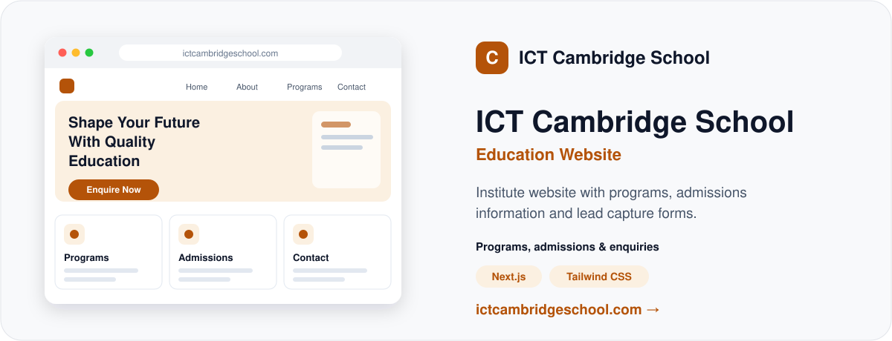
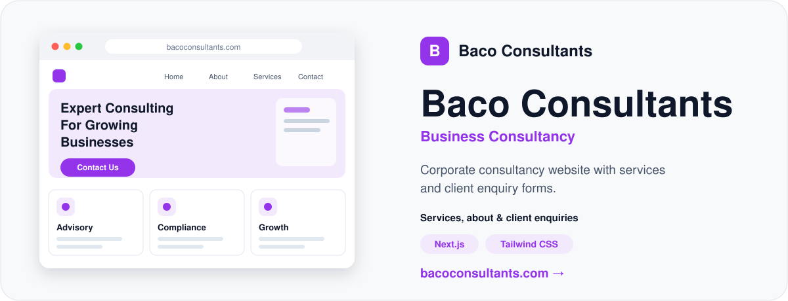

# Hi 👋, I'm Meer Ali Shah
### Full-Stack, Mobile App & ERPNext / Frappe Developer

  

---

## 🚀 About Me

- 💻 **Specialty:** Scalable full-stack web/mobile apps & enterprise ERPNext/Frappe solutions.
- 🛠️ **Core Stack:** Next.js, React, Node.js, Python, TypeScript, Tailwind CSS, Docker & PostgreSQL.
- 🔌 **Integrations:** Biometric hardware listeners, custom REST APIs, automated CRM & LMS workflows.
- 🎯 **Goal:** Clean, maintainable, high-performance code for global clients.

---

## 🌐 Featured Projects

---

## 🛠️ Tech Stack & Frameworks

### 💻 Web & Mobile Development

### 🐍 Backend & Enterprise Solutions

### 🗄️ Databases & DevOps

---

## ⚡ GitHub Stats & Activity

  
  

---

### 📫 Connect with me

